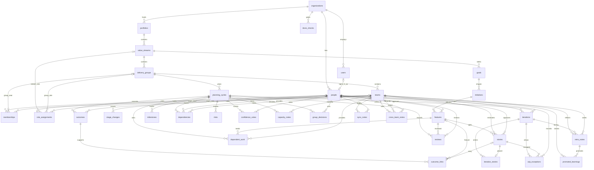

# Entity diagram

Tables created through epic 07, as stored when epic 08 starts. Every row except `users` carries `organization_id` pointing at `organizations`. `users.organization_id` is filled once the local organization exists.

## How each table links

| Table | Links |
| --- | --- |
| users | `organization_id` to organizations. A person points back through `people.user_id`. |
| organizations | Parent of people, portfolios, and every later row's `organization_id`. |
| people | `organization_id` to organizations. `user_id` to users, when the person can sign in. |
| portfolios | `organization_id` to organizations. |
| value_streams | `portfolio_id` to portfolios. |
| delivery_groups | `value_stream_id` to value_streams. |
| teams | `delivery_group_id` to delivery_groups. |
| memberships | `person_id` to people. One of `delivery_group_id` or `team_id`, not both. |
| role_assignments | `person_id` to people, one row per person. A stream owner sets `value_stream_id`. A group facilitator, product manager, or business stakeholder sets `delivery_group_id`. A product owner, scrum master, technical lead, or team member may set `team_id`. |
| goals | `value_stream_id` to value_streams. |
| initiatives | `goal_id` to goals. |
| features | `initiative_id` to initiatives. `approved_by_person_id` to people. |
| stories | `feature_id` to features. `team_id` to teams. `approved_by_person_id` to people. |
| stage_changes | `person_id` to people. `target_kind` and `target_id` point at a feature or a story. There is no foreign key on the target. |
| done_checks | `target_kind` and `target_id` point at a feature or a story, same as stage_changes. The primary key is that pair plus `item`. |
| planning_cycles | `delivery_group_id` to delivery_groups. |
| outcomes | `cycle_id` to planning_cycles. `team_id` to teams when the outcome belongs to a team. |
| milestones | `cycle_id` to planning_cycles. |
| dependencies | `cycle_id` to planning_cycles. `owner_person_id` to people. `providing_team_id` to teams. |
| dependent_work | `cycle_id` to planning_cycles. `feature_id` to features. `providing_team_id` to teams. |
| reviews | `cycle_id` to planning_cycles. `feature_id` to features. `reviewer_person_id` to people. One row per cycle, feature, and kind. |
| risks | `cycle_id` to planning_cycles. |
| confidence_votes | `cycle_id` to planning_cycles. `person_id` to people. One score per person on a cycle. |
| capacity_notes | `cycle_id` to planning_cycles. `team_id` to teams. One note per team on a cycle. |
| outcome_links | `outcome_id` to outcomes. One of `feature_id` or `story_id`. |
| group_decisions | `cycle_id` to planning_cycles. `person_id` to people. |
| iterations | `team_id` to teams. `cycle_id` to planning_cycles. |
| iteration_stories | `iteration_id` to iterations. `story_id` to stories, one placement per story. |
| wip_exceptions | `iteration_id` to iterations. `story_id` to stories. `person_id` to people. |
| sync_notes | `team_id` to teams. `person_id` to people. |
| cross_team_notes | `team_id` to the asking team. `asked_team_id` to the asked team. `person_id` to people. |
| retro_notes | `team_id` to teams. `iteration_id` to iterations. `person_id` to people. |
| promoted_learnings | `team_id` to teams. `retro_note_id` to retro_notes. |

## Several projects on one delivery group

One delivery group may hold more than one project. Each project has to keep its own iteration board, its own features, and its own plan. A person who can see one of those does not see the others from that fact alone.

The tables above do not draw that boundary:

- A feature hangs off a goal on the value stream.
- A planning cycle hangs off the delivery group.
- An iteration hangs off a team.

The link from a project to the delivery group is not decided. This diagram records the boundary. It does not add a project table. The app still stores one cycle on the group, one feature list on the stream, and one iteration on the team.
